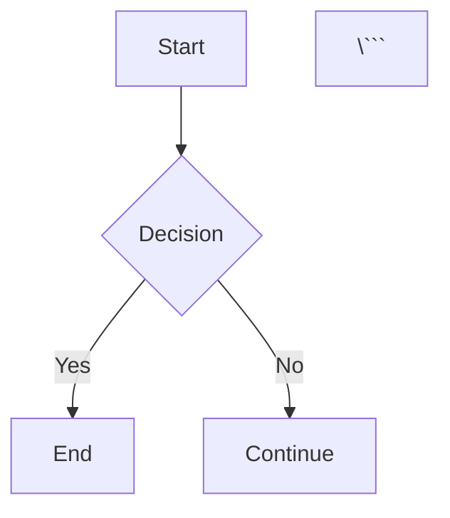

# mdviewer 📖

A beautiful, cross-platform terminal markdown viewer with Mermaid diagram support, built in Go.

## Features

### Core Rendering
- ✨ **Beautiful ANSI rendering** - Styled markdown output in your terminal with syntax highlighting
- 🎨 **Multiple themes** - Auto-detect, dark, light, or custom styles (including clean style without hash prefixes)
- 📏 **Smart word wrapping** - Auto-detects terminal width for optimal display
- 🚀 **Fast and lightweight** - Single binary with embedded dependencies

### Images & Diagrams
- 📊 **Local Mermaid rendering** - Renders diagrams locally using chromedp (no internet required!)
- 🖼️ **Inline image display** - Shows images directly in supported terminals (Warp, iTerm2, Kitty, Windows Terminal, VSCode, WezTerm)
- 📐 **Smart image resizing** - Bilinear interpolation with aspect ratio preservation
- 🎯 **Multiple rendering modes** - Terminal, SVG export, PNG export, or URL fallback for diagrams
- 💾 **Memory-efficient** - Terminal mode works in-memory by default; save to disk only when needed

### Obsidian Integration
- 🔗 **Wiki-link support** - Converts `[[page]]` and `[[page|label]]` to standard markdown links
- 🖼️ **Image embeds** - Supports `![[image.png]]` syntax with automatic path resolution
- 📏 **Sizing syntax** - `![[image.png|400]]` resizes images to specified width
- 📁 **Smart path resolution** - Relative paths resolved from markdown file directory

### Advanced Features
- 🔄 **Stdin support** - Pipe markdown content from any source
- 🖨️ **PDF export** - Export markdown with fully rendered diagrams and images to PDF
- 🪟 **Cross-platform** - Works seamlessly on macOS, Linux, and Windows
- 🎭 **Protocol auto-detection** - Automatically detects and uses appropriate terminal image protocols
- 📝 **Neovim integration** - Full-featured plugin for in-editor live preview (`contrib/neovim/mdviewer.nvim`)

## Installation

### Prebuilt binaries (recommended)

You can download ready-to-use binaries from the **GitHub Releases** page:
- https://github.com/aquele-dinho/mdviewer/releases

- Binaries are built automatically by GitHub Actions for each tag starting with `v` (for example: `v1.0.0`).
- Supported platforms:
  - macOS (Intel, Apple Silicon)
  - Linux (AMD64, ARM64)
  - Windows (AMD64)
- Each release includes compressed archives:
  - `mdviewer-darwin-amd64.tar.gz`
  - `mdviewer-darwin-arm64.tar.gz`
  - `mdviewer-linux-amd64.tar.gz`
  - `mdviewer-linux-arm64.tar.gz`
  - `mdviewer-windows-amd64.zip`
- Each release also includes a `checksums.txt` file with SHA-256 hashes for all archives and binaries.

To download and install:
1. Open the **Releases** page: https://github.com/aquele-dinho/mdviewer/releases
2. Pick the desired version (tag `vX.Y.Z`).
3. Download the archive matching your OS/architecture.
4. (Optional) Verify the SHA-256 checksum using `checksums.txt`.
5. Extract the archive:
   - macOS/Linux (`.tar.gz`): `tar -xzf mdviewer-<platform>.tar.gz`
   - Windows (`.zip`): use File Explorer or `Expand-Archive` in PowerShell.
6. On Unix-like systems, make the binary executable if needed: `chmod +x mdviewer-*`.
7. Run `./mdviewer --help` or `./mdviewer --version` to verify it works.

### Make `mdviewer` available system-wide

#### macOS & Linux

1. Move the binary into a directory on your `PATH` (for example `/usr/local/bin` or `~/.local/bin`):
   ```bash
   sudo mv mdviewer-* /usr/local/bin/mdviewer
   # or, without sudo if you use ~/.local/bin
   mkdir -p ~/.local/bin
   mv mdviewer-* ~/.local/bin/mdviewer
   ```
2. Ensure the directory is on your `PATH` (for `~/.local/bin`, add this to your shell config like `~/.zshrc` or `~/.bashrc`):
   ```bash
   export PATH="$HOME/.local/bin:$PATH"
   ```
3. Restart your shell or source your config file, then run:
   ```bash
   mdviewer --version
   ```

#### Windows (PowerShell)

1. Extract `mdviewer-windows-amd64.zip` and rename the binary if you like (for example `mdviewer.exe`).
2. Move it into a directory on your `PATH` (for example `C:\\Users\\<you>\\bin`):
   ```powershell
   New-Item -ItemType Directory -Force "$env:USERPROFILE\bin" | Out-Null
   Move-Item ".\mdviewer-windows-amd64.exe" "$env:USERPROFILE\bin\mdviewer.exe"
   ```
3. Add that directory to your user `PATH` (Windows Settings → System → About → Advanced system settings → Environment Variables), or from PowerShell:
   ```powershell
   [Environment]::SetEnvironmentVariable("Path", $env:Path + ";$env:USERPROFILE\bin", "User")
   ```
4. Open a new terminal and run:
   ```powershell
   mdviewer --version
   ```

### From Source

```bash
go install github.com/aquele_dinho/mdviewer/cmd/mdviewer@latest
```

### Build Locally

```bash
git clone https://github.com/aquele_dinho/mdviewer.git
cd mdviewer
go build -o mdviewer ./cmd/mdviewer
```

## Usage

### Basic Usage

```bash
# View a markdown file
mdviewer README.md

# Read from stdin
cat document.md | mdviewer
echo "# Hello World" | mdviewer

# Use with less for scrolling
mdviewer large-doc.md | less -R
```

### Options

```bash
# Use dark theme
mdviewer document.md --style dark

# Use light theme
mdviewer document.md --style light

# Use clean style (no hash prefixes on headings)
mdviewer document.md --style clean

# Custom terminal width
mdviewer document.md --width 100

# Disable mermaid detection
mdviewer document.md --no-mermaid

# Mermaid rendering modes
mdviewer document.md --mermaid-mode=terminal  # Default: Memory-only (inline or ASCII preview)
mdviewer document.md --mermaid-mode=svg       # Export SVGs to temp directory
mdviewer document.md --mermaid-mode=png       # Export PNGs to temp directory
mdviewer document.md --mermaid-mode=url       # Show URLs + code (no local rendering)

# Save Mermaid diagrams to disk (terminal mode only)
mdviewer document.md --keep-mermaid-files     # Saves SVG files to temp directory
mdviewer document.md -k --mermaid-output-dir=./diagrams  # Save to custom directory

# Export to PDF
mdviewer document.md --export-pdf output.pdf
```

### Help

```bash
mdviewer --help
mdviewer --version
```

## Supported Markdown Features

- **Headings** (H1-H6)
- **Bold**, *Italic*, `Code`
- Lists (ordered and unordered)
- Tables
- Blockquotes
- Code blocks with syntax highlighting
- Links (standard markdown and Obsidian wiki-links)
- **Images** with inline display and resizing support
- Horizontal rules
- Mermaid diagrams (rendered inline or exported)

## Mermaid Diagram Support

mdviewer now renders Mermaid diagrams **locally** using headless Chrome (chromedp). No internet connection required!

> Security note: for PDF export and local Mermaid rendering, mdviewer allows raw HTML from your markdown (via Goldmark's `WithUnsafe` option). This is intended for local workflows where you trust the content. Be cautious when rendering untrusted markdown, as it may include arbitrary HTML that headless Chrome will process.

```markdown


### Rendering Modes

#### Terminal Mode (Default)
Displays diagrams inline (if your terminal supports it) or as an ASCII preview box. **Files are kept in memory by default** - no disk files are created unless you use `--keep-mermaid-files`:

**Inline Image Support** (auto-detected):
- ✅ **Warp Terminal** (iTerm2 protocol)
- ✅ **iTerm2** on macOS (iTerm2 protocol)
- ✅ **Kitty** terminal (Kitty graphics protocol)
- ✅ **Windows Terminal** v1.22+ (Sixel/iTerm2 protocol)
- ✅ **VSCode** integrated terminal (iTerm2 protocol)
- ✅ **WezTerm** (multiple protocols)

If your terminal supports inline images, diagrams will render directly in the output:
```
📊 Mermaid Diagram (Flowchart):
[actual rendered image appears here]
```

Otherwise, you'll see an ASCII info box:
```
┌──────────────────────────────────────────────────┐
│ 📊 Mermaid Diagram: Flowchart                   │
│ 📐 Dimensions: 232x334 px                        │
│ ✅ Rendered locally                              │
└──────────────────────────────────────────────────┘
```

**To save diagrams to disk**, use the `--keep-mermaid-files` flag:
```bash
mdviewer doc.md --keep-mermaid-files
# Files saved to system temp directory by default

mdviewer doc.md -k --mermaid-output-dir=./my-diagrams
# Files saved to custom directory
```

#### SVG Mode
Exports SVG files to disk (no terminal preview):
```bash
mdviewer doc.md --mermaid-mode=svg
# Files saved to system temp directory

mdviewer doc.md --mermaid-mode=svg --mermaid-output-dir=./diagrams
# Files saved to custom directory
```

#### PNG Mode
Exports diagrams as PNG images to disk:
```bash
mdviewer doc.md --mermaid-mode=png
# Files saved to system temp directory

mdviewer doc.md --mermaid-mode=png --mermaid-output-dir=./diagrams
# Files saved to custom directory
```

#### URL Mode (Fallback)
Shows the mermaid code + clickable URLs to mermaid.live and mermaid.ink:
```bash
mdviewer doc.md --mermaid-mode=url
```

### Supported Mermaid Diagram Types

- Flowcharts
- Sequence Diagrams
- Class Diagrams
- State Diagrams
- ER Diagrams
- Gantt Charts
- Pie Charts
- Git Graphs
- User Journey Maps

## Inline Image Support

mdviewer displays images directly in supported terminals using inline image protocols with advanced rendering capabilities.

### Standard Markdown Syntax
```markdown


```

### Obsidian-Style Syntax
Full support for Obsidian's wiki-style syntax with intelligent preprocessing:

```markdown
# Basic image embed
![[image.png]]

# With width specification (resizes to 400px width, maintains aspect ratio)
![[image.png|400]]
![[photo.jpg|800]]  # Supports upscaling with bilinear interpolation

# Wiki-links for pages
[[other-page]]          # Converts to: [other-page](./other-page.md)
[[page|Custom Label]]   # Converts to: [Custom Label](./page.md)
[[docs/setup]]          # Converts to: [docs/setup](./docs/setup.md)
```

### How It Works
1. **Preprocessing**: Obsidian syntax is converted to standard markdown before rendering
2. **Content Detection**: Unified block detection identifies all images and mermaid diagrams
3. **Segmented Rendering**: Content is rendered in document order, maintaining structure
4. **Smart Resizing**: Width specifications trigger bilinear interpolation for high-quality scaling

### Supported Image Formats
- **PNG** (`.png`) - Preferred for lossless quality after resizing
- **JPEG** (`.jpg`, `.jpeg`) - Automatically converted to PNG when resized
- **GIF** (`.gif`) - Static GIF support
- **WebP** (`.webp`) - Modern format support

### Image Display Behavior

**Terminals with inline image support:**
- ✅ Images display directly in terminal output using appropriate protocol (iTerm2, Kitty, Sixel)
- ✅ Automatic bilinear interpolation resizing when width specified
- ✅ Aspect ratio always maintained
- ✅ Supports both downscaling and upscaling
- ✅ Images and Mermaid diagrams render in document order

**Terminals without inline image support:**
- ℹ️ Falls back to descriptive text representation
- ℹ️ Shows file path for reference
- ℹ️ Indicates image format and alt text

**Path Resolution:**
- ✅ **Relative paths** (e.g., `./images/photo.png`) are resolved from the markdown file's directory
- ✅ **Absolute paths** work as-is
- ✅ **Obsidian-style** bare paths (e.g., `![[photo.png]]`) are normalized to relative paths
- ❌ **HTTP/HTTPS URLs** are not displayed inline (shown as text links only)

### Image Resizing Technical Details

**Resize Algorithm:**
- Uses `golang.org/x/image/draw` with bilinear interpolation
- High-quality scaling in both directions (up and down)
- Maintains aspect ratio automatically

**Performance:**
- Original image cached in memory during resize
- Resized images encoded to PNG for lossless quality
- Only processes images when width specification is present

**Example:**
```markdown
![[large-image.png|400]]  # Original: 2000x1500px → Resized: 400x300px
![[small-icon.png|200]]   # Original: 50x50px → Upscaled: 200x200px
```

### Examples

```bash
# View markdown with images
mdviewer document.md

# Images will display inline in Warp, iTerm2, Kitty, etc.
# Other terminals will show text placeholders
```

## Neovim Plugin

mdviewer includes a full-featured Neovim plugin for in-editor markdown preview. Preview your markdown files in a split or floating terminal window with live auto-refresh.

### Features
- ✅ **Live preview** - Auto-refreshes as you edit (configurable debounce)
- ✅ **Flexible layout** - Vertical split, horizontal split, or floating window
- ✅ **Full mdviewer support** - All features including Mermaid diagrams and inline images
- ✅ **Path resolution** - Relative paths work correctly (preview runs in file's directory)
- ✅ **Easy setup** - Works with lazy.nvim, packer, or native packages

### Quick Start

1. **Install the plugin** (using lazy.nvim):
```lua
{
  dir = '/path/to/mdviewer/contrib/neovim/mdviewer.nvim',
  ft = 'markdown',
  opts = {
    style = 'clean',
    window_type = 'vsplit',  -- 'vsplit' | 'hsplit' | 'float'
    auto_refresh = true,
    mermaid_mode = 'terminal',
  },
}
```

2. **Use in Neovim**:
```vim
:MDViewerToggle  " Toggle preview on/off
:MDViewerRefresh " Force refresh
:MDViewerClose   " Close preview
```

3. **Optional keymap**:
```lua
vim.keymap.set('n', '<leader>mp', '<cmd>MDViewerToggle<cr>', 
  { desc = 'mdviewer: toggle preview' })
```

### Full Documentation

See the complete installation and configuration guide:
- **Plugin README**: `contrib/neovim/mdviewer.nvim/README.md`
- Includes setup for lazy.nvim, packer, and native packages
- Configuration options for styling, window type, auto-refresh, etc.

## Configuration

mdviewer uses Glamour for rendering. You can customize the appearance by:

1. Using built-in styles: `auto`, `dark`, `light`, `clean` (no hash prefixes)
2. Providing a path to a custom Glamour style JSON file

### Style Comparison

- **auto/dark/light**: Traditional styles that show `##` and `###` prefixes on H2/H3 headings
- **clean**: Modern style without hash prefixes, similar to GUI markdown viewers

## Examples

### View this README

```bash
mdviewer README.md
```

### Pipe content

```bash
curl https://raw.githubusercontent.com/username/repo/main/README.md | mdviewer
```

### Custom theme

```bash
mdviewer document.md --style /path/to/custom-style.json
```

## Project Structure

```
mdviewer/
├── cmd/
│   └── mdviewer/           # CLI entry point (Cobra-based)
│       └── main.go         # Command-line interface and flags
├── internal/
│   ├── mermaid/            # Local Mermaid compiler (chromedp)
│   │   ├── assets/         # Embedded mermaid.min.js
│   │   ├── compiler.go     # Chromedp-based renderer
│   │   ├── svg.go          # SVG utilities and dimension extraction
│   │   └── embed.go        # go:embed for mermaid.js
│   ├── renderer/           # Markdown rendering engine
│   │   ├── markdown.go     # Main ANSI renderer (Glamour)
│   │   ├── html.go         # HTML renderer (Goldmark, for PDF)
│   │   ├── mermaid.go      # Mermaid block detection
│   │   ├── images.go       # Image block detection
│   │   ├── blocks.go       # Unified content block management
│   │   ├── links.go        # Obsidian wiki-link preprocessing
│   │   └── styles.go       # Custom style definitions
│   ├── viewer/             # Display logic and segmented rendering
│   │   └── simple.go       # Terminal viewer with inline image support
│   ├── pdf/                # PDF export with chromedp
│   │   ├── exporter.go     # High-level export interface
│   │   └── chromedp.go     # Low-level PDF generation
│   └── utils/              # Utilities and helpers
│       ├── terminal.go     # Terminal width detection
│       ├── termimg.go      # Inline image protocol support
│       ├── resize.go       # Image resizing with bilinear interpolation
│       ├── file.go         # File I/O utilities
│       └── browser.go      # Browser launch utilities
├── .github/
│   └── workflows/
│       └── release.yml     # Automated multi-platform builds
├── go.mod                  # Go module dependencies
├── go.sum                  # Dependency checksums
├── build.sh                # Local build script
├── CHANGELOG.md            # Version history
├── WARP.md                 # Development guide for AI assistants
└── README.md               # This file
```

### Architecture Overview

**Content Processing Pipeline:**
```
1. Input (file/stdin)
   ↓
2. Obsidian Link Preprocessing (links.go)
   - Converts [[page]] → [page](./page.md)
   - Converts ![[image.png|400]] → 
   ↓
3. Content Block Detection (blocks.go)
   - Detects all Mermaid diagrams (mermaid.go)
   - Detects all images (images.go)
   - Sorts by document order
   ↓
4. Segmented Rendering (viewer/simple.go)
   - Renders markdown segments between special blocks
   - Processes Mermaid diagrams (via mermaid/compiler.go)
   - Processes images with resizing (via utils/resize.go)
   - Displays inline or exports to files
   ↓
5. Output (terminal or PDF)
```

**Key Design Decisions:**
- **Fresh chromedp contexts**: Each Mermaid render creates a new context to prevent memory leaks
- **Memory-first approach**: Terminal mode works entirely in-memory unless `--keep-mermaid-files` is used
- **Unified block detection**: Single pass identifies all special content (images + mermaid) for ordered rendering
- **Preprocessing before detection**: Obsidian syntax converted early to simplify downstream processing
- **Bilinear interpolation**: High-quality image scaling using `golang.org/x/image/draw`

## Development

### Release process (maintainers)

Releases are automated via GitHub Actions using the workflow in `.github/workflows/release.yml`.

1. Ensure the default branch (usually `main`) is in the desired state.
2. Create and push a version tag:
   ```bash
   git tag vX.Y.Z
   git push origin vX.Y.Z
   ```
3. GitHub Actions will:
   - Build `mdviewer` binaries for all supported platforms
   - Generate `dist/checksums.txt` with SHA-256 hashes
   - Create a GitHub Release for the tag and upload the binaries and checksums
4. Share the Release page URL with users so they can download the binaries.

The `mdviewer --version` output corresponds to the tag version (without the leading `v`).

### Prerequisites

- Go 1.21 or higher

### Building

```bash
go build -o mdviewer ./cmd/mdviewer
```

### Testing

```bash
go test ./...
```

## Roadmap

### Completed ✅
- [x] **Core Rendering**
  - [x] Basic markdown rendering with Glamour
  - [x] Multiple color themes (auto, dark, light, clean)
  - [x] Terminal width auto-detection
  - [x] Stdin support for piping
  
- [x] **Mermaid Diagrams**
  - [x] Mermaid diagram detection
  - [x] Local Mermaid rendering (chromedp)
  - [x] Multiple rendering modes (terminal, SVG, PNG, URL)
  - [x] Memory-efficient terminal mode
  - [x] Optional disk export with `--keep-mermaid-files`
  
- [x] **Images**
  - [x] Terminal inline image support (iTerm2, Kitty, Warp, Windows Terminal, VSCode, WezTerm)
  - [x] Obsidian-style syntax support (wiki-links, image embeds)
  - [x] Image resizing with bilinear interpolation
  - [x] Aspect ratio preservation
  - [x] Multiple format support (PNG, JPEG, GIF, WebP)
  - [x] Smart path resolution
  
- [x] **Export**
  - [x] PDF export with chromedp
  - [x] SVG export for diagrams
  - [x] PNG export for diagrams

- [x] **Architecture**
  - [x] Unified content block detection
  - [x] Segmented rendering in document order
  - [x] Obsidian link preprocessing
  - [x] Cross-platform support (macOS, Linux, Windows)
  - [x] Automated multi-platform builds via GitHub Actions

- [x] **Editor Integration**
  - [x] Neovim plugin for in-editor preview (`contrib/neovim/mdviewer.nvim`)

### Planned 🎯
- [ ] **Interactive Features**
  - [ ] Interactive TUI mode with Bubbletea
  - [ ] Search functionality
  - [ ] Link navigation (follow links within documents)
  - [ ] Keyboard shortcuts for common actions
  
- [ ] **Live Editing**
  - [ ] Watch mode for live markdown updates
  - [ ] Auto-reload on file changes
  - [ ] Side-by-side preview mode
  
- [ ] **Customization**
  - [ ] Custom style editor/creator
  - [ ] Theme marketplace or gallery
  - [ ] Configuration file support (`.mdviewerrc`)
  - [ ] Backlinks support
  - [ ] Tag navigation
  - [ ] Graph view for linked notes
  - [ ] Transclusion support
  
- [ ] **Performance & Optimization**
  - [ ] Caching for rendered Mermaid diagrams
  - [ ] Parallel rendering for multiple diagrams
  - [ ] Incremental rendering for large documents

### Under Consideration 💭
- [ ] **Additional Editor Integrations**
  - [ ] VSCode extension integration
  - [ ] Emacs mode
  - [ ] Vim plugin (classic Vim)
- [ ] **Advanced Rendering**
  - [ ] Math equation rendering (KaTeX/MathJax)
  - [ ] Network diagram rendering (beyond Mermaid)
  - [ ] Notebook format support (Jupyter, Observable)
- [ ] **Export & Presentation**
  - [ ] Presentation mode (slides from markdown)
  - [ ] Export to more formats (DOCX, EPUB)
- [ ] **Extensibility**
  - [ ] Custom plugin system
  - [ ] API for external integrations

## Technologies

### Core Libraries
- [Glamour](https://github.com/charmbracelet/glamour) - Terminal markdown rendering with ANSI styling
- [Cobra](https://github.com/spf13/cobra) - CLI framework for command-line interface
- [Goldmark](https://github.com/yuin/goldmark) - Markdown parser for HTML generation (PDF export)
- [Chromedp](https://github.com/chromedp/chromedp) - Headless Chrome automation for Mermaid rendering and PDF export

### Image Processing
- [golang.org/x/image/draw](https://pkg.go.dev/golang.org/x/image/draw) - High-quality image scaling with bilinear interpolation
- Standard library (`image`, `image/png`, `image/jpeg`, `image/gif`) - Image decoding and encoding

### Terminal Protocols
- **iTerm2 inline images protocol** - Base64-encoded images with escape sequences
- **Kitty graphics protocol** - Terminal-native image display
- **Sixel graphics** - Legacy but widely supported protocol

### Build & Release
- **GitHub Actions** - Automated multi-platform builds and releases
- **Go build system** - Cross-compilation for macOS, Linux, and Windows

## Contributing

Contributions are welcome! Please feel free to submit a Pull Request.

## License

MIT License

## Author

Built with ❤️ by [@aquele_dinho](https://github.com/aquele_dinho)

## Acknowledgments

- The [Charm](https://charm.sh/) team for Glamour and Bubbletea
- The Go community for excellent libraries
